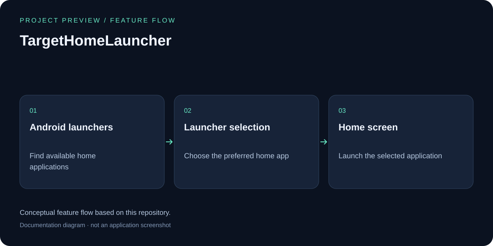

# Target Home Launcher

## Feature overview



Conceptual feature flow based on this repository; this is a documentation diagram, not an application screenshot.

An Android application that allows users to easily select and switch between different home launcher applications on their Android device.

## Overview

**Target Home Launcher** is a lightweight utility app that simplifies the process of choosing and managing your default home launcher on Android devices. Instead of navigating through system settings, users can configure their preferred home app directly within this application.

## Features

- 🏠 **Easy Launcher Selection** - Quickly select your preferred home launcher application
- ⚙️ **Configuration Settings** - Configure and manage your default home app settings
- 🎯 **Target-Based Launching** - Launch your chosen home application with a single tap
- 📱 **Boot Completion Support** - Automatically configures launcher on device startup
- 🔄 **Reset Functionality** - Clear settings and reset to default configuration
- 🌍 **Multi-language Support** - Available in Traditional Chinese and English

## Requirements

- **Android Version**: 1.5+ (API level 3+)
- **Target SDK**: Android 13 (API level 33)
- **Compile SDK**: Android 13 (API level 33)

## Installation

1. Clone the repository:
   ```bash
   git clone https://github.com/yourusername/TargetHomeLauncher.git
   cd TargetHomeLauncher
   ```

2. Build the project using Gradle:
   ```bash
   ./gradlew build
   ```

3. Install on an Android device or emulator:
   ```bash
   ./gradlew installDebug
   ```

## Project Structure

```
TargetHomeLauncher/
├── app/
│   ├── src/
│   │   ├── main/
│   │   │   ├── AndroidManifest.xml          # App configuration and permissions
│   │   │   ├── java/com/bh/android/
│   │   │   │   └── TargetHomeLauncher/
│   │   │   │       ├── TargetHomeLauncher.java       # Main launcher activity
│   │   │   │       ├── TargetHomeConfigure.java      # Configuration management
│   │   │   │       ├── TargetHomeReceiver.java       # Boot completion receiver
│   │   │   │       ├── BHAppUtility.java             # Utility functions
│   │   │   │       ├── FeatureList.java              # Feature flags
│   │   │   │       └── ApplicationInfo.java          # App information
│   │   │   └── res/
│   │   │       ├── drawable/                # App icons and images
│   │   │       ├── layout/                  # UI layouts
│   │   │       └── values/                  # Strings, colors, styles
│   │   │           └── values-zh-rTW/       # Traditional Chinese strings
│   └── build.gradle                         # App-level build configuration
├── build.gradle                             # Project-level build configuration
├── settings.gradle                          # Gradle settings
├── local.properties                         # Local build properties
└── gradle/                                  # Gradle wrapper

```

## Key Components

### Activities

- **TargetHomeConfigure** - Main configuration activity where users select their preferred home launcher
- **TargetHomeLauncher** - Transparent launcher activity that redirects to the selected home app

### Broadcast Receiver

- **TargetHomeReceiver** - Listens for `BOOT_COMPLETED` broadcasts to reinitialize launcher settings on device startup

### Utilities

- **BHAppUtility** - Helper functions for safe activity launching
- **FeatureList** - Feature flags and debug configuration
- **ApplicationInfo** - Application metadata and information

## Permissions Required

- `android.permission.RECEIVE_BOOT_COMPLETED` - Listen for device boot completion
- `android.permission.RAISED_THREAD_PRIORITY` - Raise thread priority when needed
- `android.permission.GET_TASKS` - Get running tasks information
- `android.permission.INTERNET` - For AdMob integration
- `android.permission.ACCESS_NETWORK_STATE` - Check network connectivity

## Building from Source

### Prerequisites

- Android Studio 2021.1+
- JDK 11+
- Android SDK with API 33

### Build Steps

1. Open the project in Android Studio
2. Sync Gradle files
3. Build the project:
   ```bash
   ./gradlew build
   ```
4. To create a release build:
   ```bash
   ./gradlew assembleRelease
   ```

## Usage

1. **Launch the App** - Open Target Home Launcher from your app drawer
2. **Select Home App** - Choose your preferred launcher from the list of installed apps
3. **Confirm Selection** - The selected app will be set as your default home launcher
4. **Reset** - Use the reset option to clear default settings if needed

## Version History

- **v1.12** (Build: 20171120) - Latest release

## Author

©2012 Studio Bing-Huan

## License

Please refer to the LICENSE file for licensing information.

## Contributing

Contributions are welcome! Please feel free to submit issues or pull requests to improve the application.

## Support

For bug reports, feature requests, or general feedback, please open an issue on GitHub or contact the developer directly.

---

**Note**: This application is a specialized utility for managing home launcher preferences on Android devices. It requires explicit user permission through the system settings to function as the default home app.

